<!-- You're reading the source. The page below is hand-set SVG, cut into linked slices (assets/). Links are the blue [ bracketed ] labels and the project cards. -->

<picture><source media="(prefers-color-scheme: dark)" srcset="https://raw.githubusercontent.com/rudrakshchaudhry/rudrakshchaudhry/main/assets/p-dark-1-1.svg" /><source media="(prefers-color-scheme: light)" srcset="https://raw.githubusercontent.com/rudrakshchaudhry/rudrakshchaudhry/main/assets/p-light-1-1.svg" /></picture> 
<a href="https://www.linkedin.com/in/rudrakshchaudhry/"><picture><source media="(prefers-color-scheme: dark)" srcset="https://raw.githubusercontent.com/rudrakshchaudhry/rudrakshchaudhry/main/assets/p-dark-2-1.svg" /><source media="(prefers-color-scheme: light)" srcset="https://raw.githubusercontent.com/rudrakshchaudhry/rudrakshchaudhry/main/assets/p-light-2-1.svg" /></picture></a><a href="https://scholar.google.com/citations?user=Sr3EMJoAAAAJ&hl=en"><picture><source media="(prefers-color-scheme: dark)" srcset="https://raw.githubusercontent.com/rudrakshchaudhry/rudrakshchaudhry/main/assets/p-dark-2-2.svg" /><source media="(prefers-color-scheme: light)" srcset="https://raw.githubusercontent.com/rudrakshchaudhry/rudrakshchaudhry/main/assets/p-light-2-2.svg" /></picture></a><a href="https://github.com/rudrakshchaudhry?tab=repositories"><picture><source media="(prefers-color-scheme: dark)" srcset="https://raw.githubusercontent.com/rudrakshchaudhry/rudrakshchaudhry/main/assets/p-dark-2-3.svg" /><source media="(prefers-color-scheme: light)" srcset="https://raw.githubusercontent.com/rudrakshchaudhry/rudrakshchaudhry/main/assets/p-light-2-3.svg" /></picture></a><picture><source media="(prefers-color-scheme: dark)" srcset="https://raw.githubusercontent.com/rudrakshchaudhry/rudrakshchaudhry/main/assets/p-dark-2-4.svg" /><source media="(prefers-color-scheme: light)" srcset="https://raw.githubusercontent.com/rudrakshchaudhry/rudrakshchaudhry/main/assets/p-light-2-4.svg" /></picture> 
<picture><source media="(prefers-color-scheme: dark)" srcset="https://raw.githubusercontent.com/rudrakshchaudhry/rudrakshchaudhry/main/assets/p-dark-3-1.svg" /><source media="(prefers-color-scheme: light)" srcset="https://raw.githubusercontent.com/rudrakshchaudhry/rudrakshchaudhry/main/assets/p-light-3-1.svg" /></picture> 
<a href="https://github.com/rudrakshchaudhry/Spirits"><picture><source media="(prefers-color-scheme: dark)" srcset="https://raw.githubusercontent.com/rudrakshchaudhry/rudrakshchaudhry/main/assets/p-dark-4-1.svg" /><source media="(prefers-color-scheme: light)" srcset="https://raw.githubusercontent.com/rudrakshchaudhry/rudrakshchaudhry/main/assets/p-light-4-1.svg" /></picture></a><a href="https://github.com/rudrakshchaudhry/Hallway"><picture><source media="(prefers-color-scheme: dark)" srcset="https://raw.githubusercontent.com/rudrakshchaudhry/rudrakshchaudhry/main/assets/p-dark-4-2.svg" /><source media="(prefers-color-scheme: light)" srcset="https://raw.githubusercontent.com/rudrakshchaudhry/rudrakshchaudhry/main/assets/p-light-4-2.svg" /></picture></a> 
<a href="https://github.com/rudrakshchaudhry/Plowtion"><picture><source media="(prefers-color-scheme: dark)" srcset="https://raw.githubusercontent.com/rudrakshchaudhry/rudrakshchaudhry/main/assets/p-dark-5-1.svg" /><source media="(prefers-color-scheme: light)" srcset="https://raw.githubusercontent.com/rudrakshchaudhry/rudrakshchaudhry/main/assets/p-light-5-1.svg" /></picture></a><a href="https://github.com/rudrakshchaudhry/RandomForestRegressor"><picture><source media="(prefers-color-scheme: dark)" srcset="https://raw.githubusercontent.com/rudrakshchaudhry/rudrakshchaudhry/main/assets/p-dark-5-2.svg" /><source media="(prefers-color-scheme: light)" srcset="https://raw.githubusercontent.com/rudrakshchaudhry/rudrakshchaudhry/main/assets/p-light-5-2.svg" /></picture></a> 
<picture><source media="(prefers-color-scheme: dark)" srcset="https://raw.githubusercontent.com/rudrakshchaudhry/rudrakshchaudhry/main/assets/p-dark-6-1.svg" /><source media="(prefers-color-scheme: light)" srcset="https://raw.githubusercontent.com/rudrakshchaudhry/rudrakshchaudhry/main/assets/p-light-6-1.svg" /></picture> 

