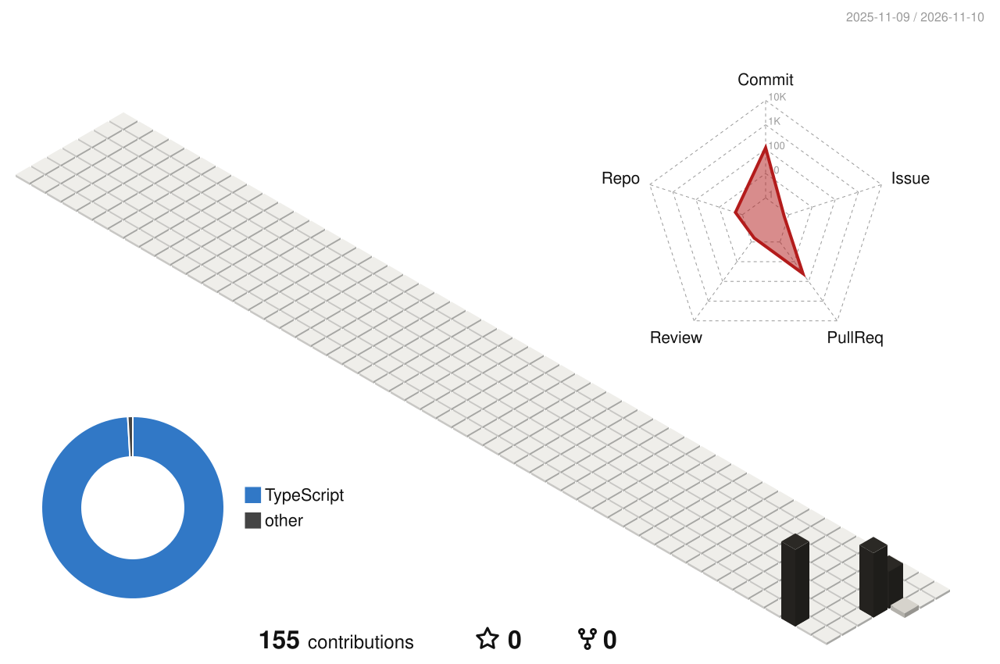

<!-- You're reading the source. The page below is hand-set SVG (assets/). Say hi on LinkedIn. -->

<p align="center">
  <picture>
    <source media="(prefers-color-scheme: dark)" srcset="https://raw.githubusercontent.com/rudrakshchaudhry/rudrakshchaudhry/main/assets/profile-dark.svg" />
    <source media="(prefers-color-scheme: light)" srcset="https://raw.githubusercontent.com/rudrakshchaudhry/rudrakshchaudhry/main/assets/profile-light.svg" />
    
  </picture>
</p>

<p align="center">
  <samp>
    <a href="https://www.linkedin.com/in/rudrakshchaudhry/">linkedin</a> ·
    <a href="https://scholar.google.com/citations?user=Sr3EMJoAAAAJ&hl=en">google scholar</a> ·
    <a href="https://github.com/rudrakshchaudhry/Spirits">[1] spirits</a> ·
    <a href="https://github.com/rudrakshchaudhry/Hallway">[2] hallway</a> ·
    <a href="https://github.com/rudrakshchaudhry/Plowtion">[3] plowtion</a>
  </samp>
</p>

<details>
  <summary><samp>cite this profile</samp></summary>

```bibtex
@misc{chaudhry,
  author       = {Chaudhry, Rudraksh},
  title        = {Rudraksh Chaudhry: Selected Work},
  howpublished = {\url{https://github.com/rudrakshchaudhry}},
  note         = {GitHub profile}
}
```

</details>

<br />

<p align="center">
  <picture>
    <source media="(prefers-color-scheme: dark)" srcset="https://raw.githubusercontent.com/rudrakshchaudhry/rudrakshchaudhry/main/profile-3d-contrib/profile-paper-dark.svg" />
    <source media="(prefers-color-scheme: light)" srcset="https://raw.githubusercontent.com/rudrakshchaudhry/rudrakshchaudhry/main/profile-3d-contrib/profile-paper-light.svg" />
    
  </picture>
  <br />
  <sub><i>Figure 2: Contributions over the past year, redrawn daily.</i></sub>
</p>
